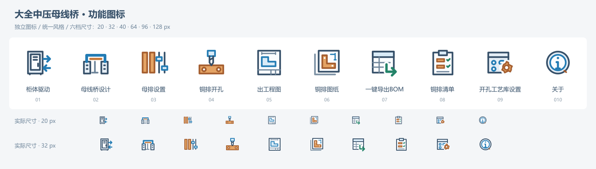

# 大全中压母线桥工具栏图标



SVG 源图位于 `src/`，统一采用蓝灰柜体与图纸、铜橙母排、绿色导出与清单标识。
采用明确轮廓和少量细节，避免小尺寸文字；背景透明。

项目统一约束及验证边界见[现行文档](../../docs/README.md)。

`toolbar-icons.json` 定义从左到右的图标顺序，与 `SwAddin.ToolbarIconIndex` 对应。
图标索引与 SolidWorks 命令 ID 是不同概念，不应混用。

| 索引 | 功能 | 图形 |
| --- | --- | --- |
| 0 | 柜体驱动 | 柜体、双向驱动箭头 |
| 1 | 母线桥设计 | 双柜、桥体、中间支撑 |
| 2 | 母排设置 | 铜排、调节滑杆 |
| 3 | 铜排开孔 | 铜排孔位、钻头 |
| 4 | 出工程图 | 工程图纸、尺寸线、标题栏 |
| 5 | 铜排图纸 | 叠放图纸、带孔折弯铜排 |
| 6 | 一键导出BOM | 表格、导出箭头 |
| 7 | 铜排清单 | 清单板、铜排条目、勾选标记 |
| 8 | 开孔工艺库设置 | 孔型库、设置齿轮 |

索引9为“关于”的信息圆环图标，显示在“开孔工艺库设置”右侧。索引2为已并入母线桥设计的母排设置保留图标，清单中标记reserved，不重新注册独立按钮。

## 资源生成与检查

使用 Node.js 和 `sharp`。也可以通过 `--sharp-module` 指向已有 sharp 模块目录，无需修改项目依赖。

```powershell
node tools/generate-toolbar-icons.cjs
node tools/generate-toolbar-icons.cjs --check
```

生成器输出六档 `toolbar{size}x.png`，每条宽度为 `10 × size`、高度为 `size`，
以及对应 `mainicon_{size}.png`（桥体图标）和 `preview.png`。
所有运行时 PNG 沿用原来的嵌入资源名称，不增加插件运行时依赖。
修改 SVG 后运行生成器；`--check` 比较源图渲染结果与现有 PNG，并检查按钮索引及资源嵌入。
这两个命令均不会构建项目、注册 COM 或启动 SolidWorks。

资源当前随 DLL 嵌入；源代码与资源更新需要在后续正常编译、部署并重新加载插件后才会显示。
`preview.png` 是设计预览，不是 SolidWorks 实机截图。
